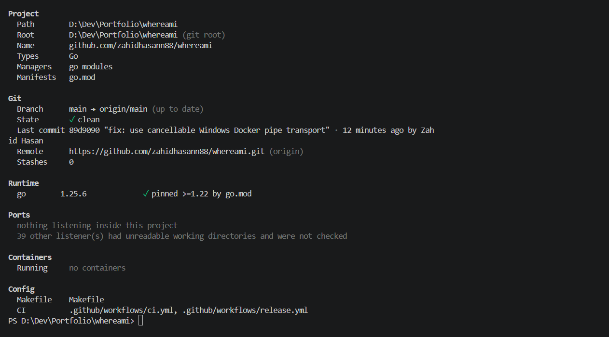

# whereami

[](https://github.com/zahidhasann88/whereami/actions/workflows/ci.yml)

A one-screen summary of the project you are standing in: its type, Git state, runtime versions, listening ports, containers and config files.

```sh
cd ~/code/shop-web
whereami
```



Useful when you jump between many projects, or open a repo you haven't touched in months.

It is read-only and fast. Sections run in parallel, each with a time budget, and a missing tool or failing section never stops the rest.

## Install

With Go 1.22 or newer:

```sh
go install github.com/zahidhasann88/whereami/cmd/whereami@latest
```

Or download a binary for Linux, macOS or Windows from the [Releases page](https://github.com/zahidhasann88/whereami/releases).

To build from source:

```sh
git clone https://github.com/zahidhasann88/whereami
cd whereami
go build -o bin/whereami ./cmd/whereami
```

## Usage

```
whereami [section] [flags]
```

Sections: `project`, `git`, `runtime`, `ports`, `containers`, `config`. With no section, all six are shown.

```sh
whereami                  # full summary
whereami git              # only the Git section
whereami --json           # machine-readable output
whereami --path ../api    # inspect another directory
```

| Flag | Meaning |
| --- | --- |
| `--json` | Print JSON instead of text |
| `--path <dir>` | Inspect another directory |
| `--no-color` | Disable colour (also off when piped or `NO_COLOR` is set) |
| `--no-docker` | Do not contact Docker |
| `--show-env-keys` | List env variable names (never values) |
| `--timeout <duration>` | Time budget per section (default `2s`) |
| `--version` | Print version info |

Exit codes: `0` success, `2` usage error, `3` unexpected error.

## What it shows

- **Project**: root directory, name, languages, frameworks and package managers, detected from manifests like `go.mod`, `package.json`, `pyproject.toml`, `Cargo.toml`, `pom.xml` and more.
- **Git**: branch, upstream ahead/behind, dirty state, last commit, remote and stash count.
- **Runtime**: installed versions of relevant runtimes (`go`, `node`, `python`, `rustc`, `java`, ...), checked against pins such as `.nvmrc`, `engines.node`, `go.mod` or `.python-version`.
- **Ports**: TCP listeners owned by processes running inside the project.
- **Containers**: Compose files and their services, plus running Docker containers that belong to the project.
- **Config**: `.env` files (with a warning if not gitignored), Dockerfiles, Makefiles and CI configs.

## Security

whereami is safe to run in directories that hold secrets:

- Values in `.env` files are never shown, only how many variables there are (and their names, if you pass `--show-env-keys`).
- Credentials are stripped from git remote URLs.
- Git and Docker are queried read-only, and there is no network access besides the local Docker socket.

## Development

```sh
make check   # gofmt, go vet, go test
make lint    # golangci-lint
```

## License

MIT. See [LICENSE](LICENSE).
